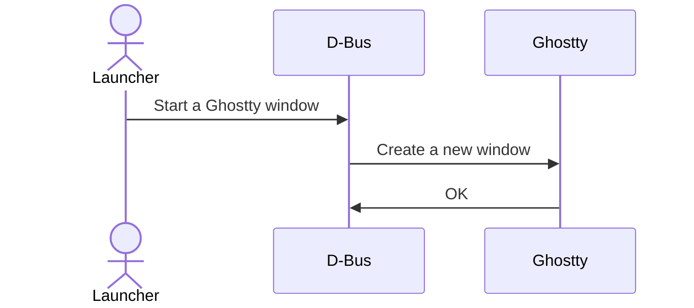
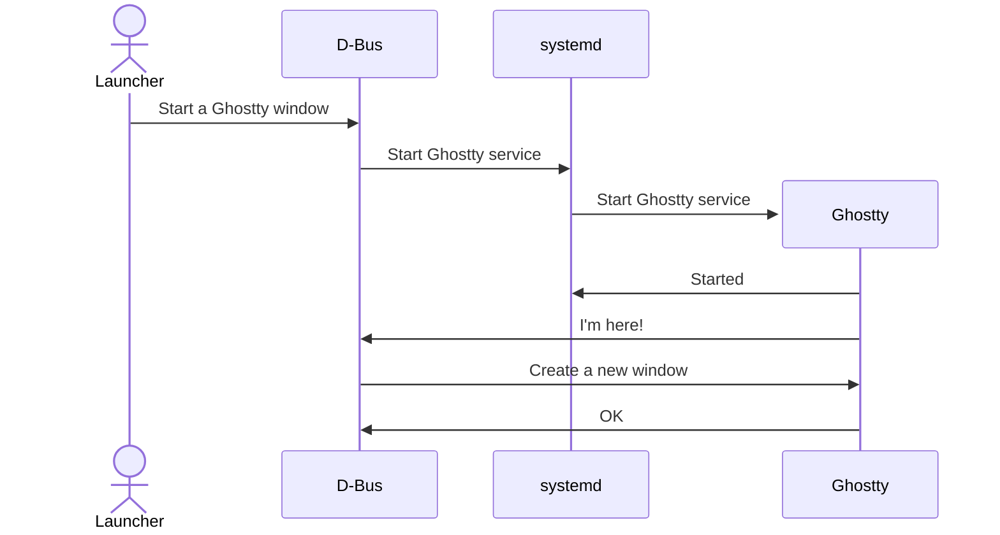

適切にインストールされている場合[^1]、Ghostty には複数の systemd ユニットが付属します。
これらの systemd ユニットを通じて Ghostty を実行する方法を推奨します。
Ghostty の systemd 統合がもたらす特に重要な利点は、即時起動[^2]とログの一元管理の 2 つです。

`systemd` のあるシステムで、システムパッケージから、または[ドキュメントの手順どおりに](/docs/install/build)
Ghostty をインストールした場合は、*そのまま動く*はずです。
全体の仕組みを理解したい場合やトラブルシューティングを行う場合を除き、
このドキュメントを読む必要はありません。

<Important>
  Ghostty の実行に **systemd は必須ではありません**。systemd のないどのシステムでも、
  `ghostty` バイナリを直接実行すれば Ghostty は動作します。
  ただし、このページで説明する利点は得られません。
</Important>

<Important>
  設定ファイルで `class` を使用すると、`systemd` ユニットファイルや D-Bus アクティベーションの
  正常な動作を妨げることがあります。設定ファイルからは削除し、必要なときにだけ
  コマンドラインから明示的に指定することを推奨します。
</Important>

## ログイン時に Ghostty を起動する {/* #starting-ghostty-at-login */}

ログイン時に Ghostty をバックグラウンドで起動するように設定すると、
その後、新しいウィンドウを作成する要求に極めて高速に応答できます。
これを行うには、`systemd` で Ghostty のユーザーサービスを有効にします。

```sh
systemctl enable --user app-com.mitchellh.ghostty.service
```

これにより、ログイン時に Ghostty が起動し、ウィンドウは作成されないようにシステムが設定されます。
起動の遅延は、ログイン後にシステムがすべてのセットアップを完了するまでにかかる時間に「隠れる」ことになります。

設定にいくつかの項目を追加すると、使い勝手をさらに改善できます。

```
quit-after-last-window-closed = true
quit-after-last-window-closed-delay = 5m
```

この設定では、最後のウィンドウを閉じてから 5 分後に Ghostty が終了するため、
しばらく Ghostty を使っていないときにメモリを節約できます。

```
quit-after-last-window-closed = false
```

この設定では、Ghostty を常に実行したままにするため、新しいウィンドウの作成が常に高速になります。

## 設定を再読み込みする {/* #reloading-the-config */}

次のコマンドを使用すると、（スクリプトや CLI から）Ghostty に設定の再読み込みを指示できます。

```sh
systemctl reload --user app-com.mitchellh.ghostty.service
```

内部では、単に Ghostty のメインプロセスに SIGUSR2 を送信していますが、
Ghostty のメインプロセスを追跡する処理は `systemd` が担当します。
`ps` などのユーティリティを使ってこの処理をスクリプト化すると、確実に動作しない場合があります。

## スクリプトから新しいウィンドウを作成する {/* #scripting-new-windows */}

引数なしで `ghostty` CLI を使うと、新しいウィンドウを作成できます。
ただし、systemd と D-Bus の統合を利用している場合は、代わりに `ghostty +new-window` を使う方がはるかに高速です。

`+new-window` コマンドは、D-Bus を直接使用して新しいウィンドウを作成します。
Ghostty が実行されていない場合は、D-Bus アクティベーションユニットが Ghostty を起動します。
通常の `ghostty` の実行では、同じ結果に到達するまでに、設定の読み込み、環境の調査、GTK の初期化などが必要になるため、
この方法の方がはるかに高速です。

```sh
ghostty +new-window
```

D-Bus アクティベーションによって Ghostty が起動するため、
Ghostty がまだ実行されていなくても、新しいウィンドウが作成されます。

このコマンドは、特に i3、Hyprland、River などのウィンドウマネージャーで非常に便利です。

### Hyprland {/* #hyprland */}

以下は、Hyprland で `super+return` を押すと新しい Ghostty ウィンドウを開くようにするキーバインドの例です。
通常、この設定は `~/.config/hypr/hyprland.conf` に記述します。

```
bind = SUPER, return, exec, ghostty +new-window
```

## 起動の仕組み {/* #how-launching-works */}

`systemd` と D-Bus のあるシステムでは、Ghostty はデフォルトで D-Bus アクティベーションを通じて起動します。

アプリケーションランチャーは、Ghostty を直接実行する代わりに、
Ghostty ウィンドウを開くよう要求するシグナルを D-Bus セッションブローカーに送信します。
Ghostty は特定のバス名（`com.mitchellh.ghostty`）を取得するため、
D-Bus セッションブローカーは Ghostty が実行中かどうかを把握できます。
このバス名を取得したプログラムがあれば、それを Ghostty とみなします。

ここから先の動作は、Ghostty がすでに実行されているかどうかによって異なります。

この仕組みにより、アクティブなウィンドウがある場合や、Ghostty が実行を継続するよう設定されている場合
（デフォルトではありません）、GTK（またはその他の初期化）による起動の遅延は 1 度しか発生しません。

### Ghostty がすでに実行されている場合 {/* #ghostty-is-already-running */}

Ghostty がすでに実行されている場合、ブローカーは、新しいウィンドウの作成を要求する D-Bus シグナルを
Ghostty に直接送信します。Ghostty はこのシグナルを受信し、新しいウィンドウを開きます。
これは非常に高速で、負荷も非常に小さい処理です。



### Ghostty が実行されていない場合 {/* #ghostty-is-not-running */}

Ghostty が実行されていない場合、D-Bus セッションブローカーは `systemd` に対し、
ユーザーサービスで Ghostty を起動するよう要求し、起動後に新しいウィンドウを作成するための D-Bus シグナルを Ghostty に送信します。



## その他 {/* #other */}

この「その他」の節では、重要度が比較的低い情報や、使用頻度の低い情報をまとめています。
これらの情報は非常に役立つこともありますが（そのためここに記載しています）、頻繁に使うものではありません。

### ログ {/* #logs */}

systemd を通じて実行した Ghostty が出力するログは、`journalctl` を使用して確認できます。

```sh
journalctl -a -f --user -u app-com.mitchellh.ghostty.service
```

### 状態 {/* #status */}

次のコマンドで Ghostty の状態を確認できます。

```sh
systemctl status --user app-com.mitchellh.ghostty.service
```

次のような出力が表示されるはずです。

```
● app-com.mitchellh.ghostty.service - Ghostty
     Loaded: loaded (/home/mitchellh/.local/share/systemd/user/app-com.mitchellh.ghostty.service; disabled; preset: enabled)
     Active: active (running) since Fri 2025-07-11 14:05:42 PDT; 24h ago
 Invocation: 42b48b0aa1bf4134a030e38acb04b8dd
   Main PID: 2525 (ghostty)
      Tasks: 0 (limit: 71639)
     Memory: 81.4M (peak: 107.9M)
        CPU: 98ms
     CGroup: /user.slice/user-1000.slice/user@1000.service/app.slice/app-com.mitchellh.ghostty.service
             ‣ 2525 /home/mitchellh/.local/bin/ghostty --launched-from=systemd

Jul 11 14:05:42 beach ghostty[2525]: info(gtk): cgroup isolation enabled base=/user.slice/user-1000.slice/user@1000.service/app.slice/app-ghostty-transient-2525.scope
Jul 11 14:05:42 beach systemd[2268]: Started Ghostty.
Jul 11 14:05:42 beach ghostty[2525]: info(gtk): received new window action
Jul 11 14:05:42 beach ghostty[2525]: info(opengl): loaded OpenGL 4.6
Jul 11 14:05:42 beach ghostty[2525]: info(io_exec): found Ghostty resources dir: /home/mitchellh/.local/share/ghostty
```

### 停止 {/* #stopping */}

次のコマンドで Ghostty の `systemd` ユーザーサービスを停止できます。

```sh
systemctl stop --user app-com.mitchellh.ghostty.service
```

<Caution>
  これは Ghostty を正常に停止しますが、Ghostty は*確認を求めずに*すべてのウィンドウを閉じ、
  そこで実行中のプロセスを強制終了します。データや状態が失われる可能性があります。
</Caution>

### 関連ファイル {/* #relevant-files */}

適切にインストールされている場合[^1]、Ghostty には、起動のための複数の設定ファイルが付属します。

ユーザーとして（たとえば `$HOME/.local` に）インストールした場合、次のファイルが作成されます。

```
$PREFIX/share/applications/com.mitchellh.ghostty.desktop
$PREFIX/share/dbus-1/services/com.mitchellh.ghostty.service
$PREFIX/share/systemd/user/app-com.mitchellh.ghostty.service
```

システムパッケージとしてインストールした場合、次のファイルが作成されます。

```
$PREFIX/share/applications/com.mitchellh.ghostty.desktop
$PREFIX/share/dbus-1/services/com.mitchellh.ghostty.service
$PREFIX/lib/systemd/user/app-com.mitchellh.ghostty.service
```

<Warning>
  これらのファイルが適切な場所にインストールされ、正しく設定されていない場合、**Ghostty が起動しないことがあります**。
  適切な場所にインストールされているのに Ghostty が起動しない場合は、一度ログアウトしてから再びログインしてください。
  それでも解決しない場合は、システムの再起動を試してください。これが必要になることはまれですが、システムの設定によっては起こり得ます。
</Warning>

### 開発ビルド {/* #dev-builds */}

Ghostty の開発ビルド（`Debug` モード）をインストールしている場合は、
このページに記載したパスを少し変更する必要があります。

```sh
systemctl enable --user app-com.mitchellh.ghostty-debug.service
systemctl stop --user app-com.mitchellh.ghostty-debug.service
systemctl reload --user app-com.mitchellh.ghostty-debug.service
journalctl -a -f --user -u app-com.mitchellh.ghostty-debug.service
ghostty +new-window --class=com.mitchellh.ghostty-debug.service
```

ユーザーとしてインストールした場合、Ghostty のデバッグ版の起動を制御するファイルは次のとおりです。

```
$PREFIX/share/applications/com.mitchellh.ghostty-debug.desktop
$PREFIX/share/dbus-1/services/com.mitchellh.ghostty-debug.service
$PREFIX/share/systemd/user/app-com.mitchellh.ghostty-debug.service
```

システムパッケージとしてインストールした場合、ファイルは次の場所にあります。

```
$PREFIX/share/applications/com.mitchellh.ghostty-debug.desktop
$PREFIX/share/dbus-1/services/com.mitchellh.ghostty-debug.service
$PREFIX/lib/systemd/user/app-com.mitchellh.ghostty-debug.service
```

[^1]:
    「適切にインストールされている」とは、私たちのパッケージングガイドラインに従ったパッケージから、
    またはソースから `$HOME/.local` にインストールされていることを意味します。

[^2]:
    もちろん、「即時」は誇張表現です。実際には、最新のシステムで Ghostty の新しいウィンドウを起動する時間が、
    約 300 ms から約 20 ms に短縮されます。この数値はハードウェアによって異なりますが、
    相対的な速度向上はどのシステムでも実感できるはずです。
